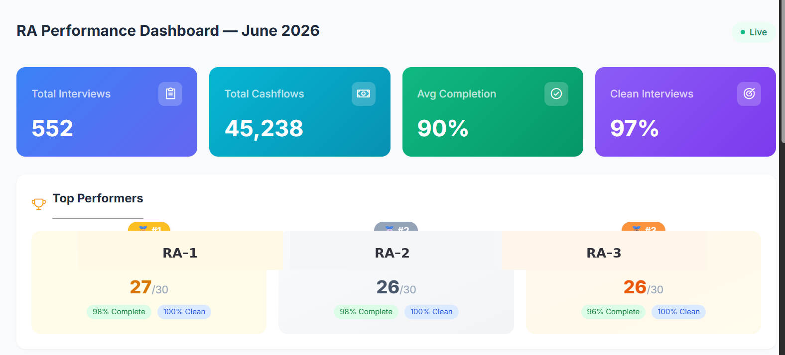
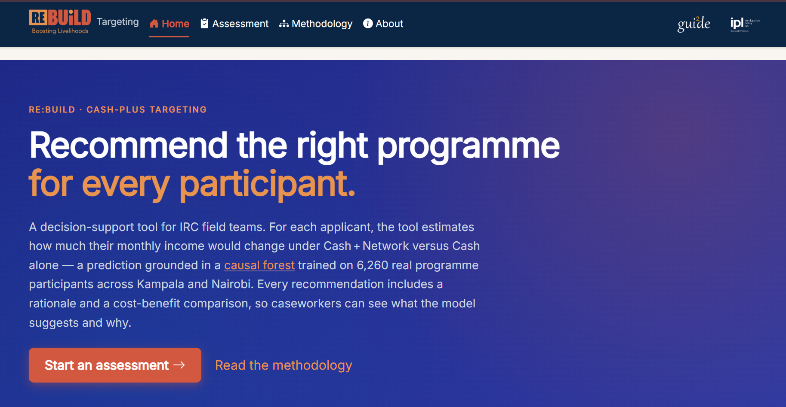

```{=html}
<main class="s-page">

<section class="s-intro" aria-label="Introduction">
  <div>
    <p class="s-intro__name" role="heading" aria-level="1">Nichodemus Amollo</p>
    <p class="s-intro__role">Statistician and epidemiologist · Nairobi, Kenya</p>
    <p class="s-lede">I build the research data systems that health and development programmes depend on, and I study how health financing shapes chronic care in Kenya.</p>
    <p>I am a Data Analyst at <a href="https://gui2de.georgetown.edu/profiles/nichodemus-amollo/">Georgetown University's gui²de</a> in East Africa. My research looks at insurance coverage, facility financing and treatment gaps for people living with hypertension, diabetes and disability, with a focus on Kenya's move from NHIF to the Social Health Authority.</p>
    <p>I also founded <a href="https://www.gpakgirls.org/team">GPAK Girls</a>, a Homa Bay organisation that supports adolescent mothers and pregnant girls in western Kenya.</p>
    <ul class="s-links" aria-label="Contact and profiles">
      <li><a href="mailto:nichodemuswerre@gmail.com">Email</a></li>
      <li><a href="cv/index.html">CV</a></li>
      <li><a href="https://orcid.org/0009-0008-1501-601X">ORCID</a></li>
      <li><a href="https://github.com/gondamol">GitHub</a></li>
      <li><a href="https://www.linkedin.com/in/nichodemusamollo/">LinkedIn</a></li>
    </ul>
  </div>
  
</section>

<section class="s-section" aria-labelledby="news-h">
  <h2 class="s-label" id="news-h">News</h2>
  <ul class="s-news">
    <li><time datetime="2026-09">Sep 2026</time><span>New preprint on <a href="https://doi.org/10.64898/2026.09.20.26363504">insurance, healthcare use and outpatient payment among adults with disability in Kenya</a> before the SHA transition (<em>medRxiv</em>).</span></li>
    <li><time datetime="2026-09">Sep 2026</time><span>New preprint arguing that <a href="https://doi.org/10.32388/GDWWI3">pragmatic lifestyle trials for type 2 diabetes remission</a> are a health system priority in sub-Saharan Africa (<em>Qeios</em>).</span></li>
    <li><time datetime="2026-05">May 2026</time><span>New preprint on <a href="https://doi.org/10.64898/2026.05.14.26353157">insurance coverage and treatment gaps among Kenyan adults with diagnosed hypertension or diabetes</a> (<em>medRxiv</em>).</span></li>
    <li><time datetime="2026-04">Apr 2026</time><span>Co-authored paper on <a href="https://doi.org/10.1186/s12875-026-03295-5">participatory design of NCD services in rural Kenya</a> published in <em>BMC Primary Care</em>.</span></li>
    <li><time datetime="2026-03">Mar 2026</time><span>First-author paper on <a href="https://doi.org/10.1186/s12889-026-26963-8">financing hypertension and diabetes care in rural Kisumu</a> published in <em>BMC Public Health</em>.</span></li>
  </ul>
</section>

<section class="s-section" aria-labelledby="research-h">
  <h2 class="s-label" id="research-h">Selected research</h2>
  <ol class="s-pubs">
    <li class="s-pub">
      <p class="s-pub__title"><a href="https://doi.org/10.1186/s12889-026-26963-8">Financial determinants of effective hypertension and diabetes care in rural primary health facilities in Kisumu, Kenya: a mixed-methods study</a></p>
      <p class="s-pub__authors"><strong>Amollo NW</strong>, Ogol J, Museve E, Owenga JA, Aduda DO, Onguru D</p>
      <p class="s-pub__venue"><em>BMC Public Health</em>, 2026</p>
    </li>
    <li class="s-pub">
      <p class="s-pub__title"><a href="https://doi.org/10.64898/2026.09.20.26363504">Insurance coverage, healthcare use, and outpatient payment among adults with disability in Kenya before the SHA transition: a secondary analysis of KDHS 2022</a></p>
      <p class="s-pub__authors"><strong>Amollo NW</strong>, Ogol J</p>
      <p class="s-pub__venue"><em>medRxiv</em>, 2026 <span class="s-tag">Preprint</span></p>
    </li>
    <li class="s-pub">
      <p class="s-pub__title"><a href="https://doi.org/10.64898/2026.05.14.26353157">Health insurance coverage, affordability barriers, and treatment gaps among Kenyan adults with diagnosed hypertension or diabetes before the Social Health Authority transition</a></p>
      <p class="s-pub__authors"><strong>Amollo NW</strong>, Hyera HF, Ouma OJ</p>
      <p class="s-pub__venue"><em>medRxiv</em>, 2026 <span class="s-tag">Preprint</span></p>
    </li>
  </ol>
  <p class="s-more"><a href="research/publications.html">All publications and summaries →</a></p>
</section>

<section class="s-section" aria-labelledby="work-h">
  <h2 class="s-label" id="work-h">Selected work</h2>
  <ul class="s-work">
    <li>
      <a class="s-work__row" href="projects/health-financial-diaries/index.html">
        
        <div>
          <p class="s-work__title">Health financial diaries data system</p>
          <p class="s-work__meta">Georgetown gui²de · FSD Kenya</p>
          <p class="s-work__desc">Data architecture for a 300-household, twelve-month diaries panel: automated high-frequency checks, an RA leaderboard and a live issues app that supervisors used during collection.</p>
        </div>
      </a>
    </li>
    <li>
      <a class="s-work__row" href="projects/rebuild-targeting/index.html">
        
        <div>
          <p class="s-work__title">Cash-plus targeting recommender</p>
          <p class="s-work__meta">IRC Re:BUiLD · Georgetown gui²de</p>
          <p class="s-work__desc">A Shiny app that turns gui²de's causal forest models over 6,260 participants into a recommendation caseworkers can read, with the cost reasoning attached.</p>
        </div>
      </a>
    </li>
    <li>
      <a class="s-work__row" href="posts/kisumu-cancer-dashboard/index.html">
        
        <div>
          <p class="s-work__title">Kisumu cancer surveillance dashboard</p>
          <p class="s-work__meta">KEMRI · Oncology</p>
          <p class="s-work__desc">REDCap registry design, quality control and survival analysis behind a county-facing cancer dashboard, launched with Kisumu health leadership.</p>
        </div>
      </a>
    </li>
  </ul>
  <p class="s-more"><a href="projects/index.html">All projects →</a></p>
</section>

<section class="s-section" aria-labelledby="writing-h">
  <h2 class="s-label" id="writing-h">Writing</h2>
  <ul class="s-list">
    <li><a href="posts/47-facility-decision-space-chronic-care/index.html">When clinics can diagnose but cannot buy medicines</a><span class="s-list__meta">What the BMC Public Health paper means for chronic care budgets</span></li>
    <li><a href="posts/30-health-financial-diaries-explainer/index.html">The systems behind a year of health financial diaries</a><span class="s-list__meta">Quality checks and live field apps on a streaming study database</span></li>
    <li><a href="posts/48-from-field-to-model/index.html">From field to model</a><span class="s-list__meta">Why domain knowledge still decides whether a targeting model is useful</span></li>
  </ul>
  <p class="s-more"><a href="blogs/index.html">All writing →</a></p>
</section>

<section class="s-section" aria-labelledby="contact-h">
  <h2 class="s-label" id="contact-h">Contact</h2>
  <p>I am open to research collaborations on health financing and chronic care, and to roles leading research data systems for health and development programmes. The best way to reach me is <a href="mailto:nichodemuswerre@gmail.com">nichodemuswerre@gmail.com</a>.</p>
</section>

</main>
```
